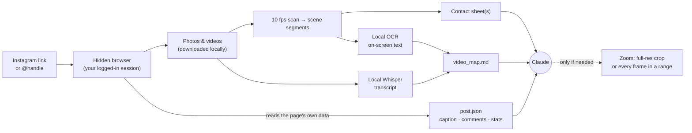
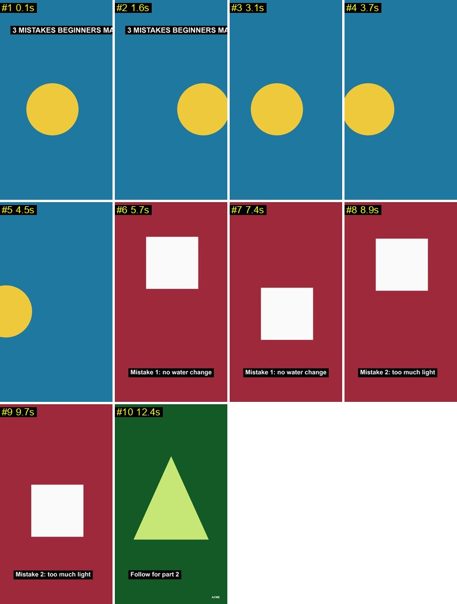
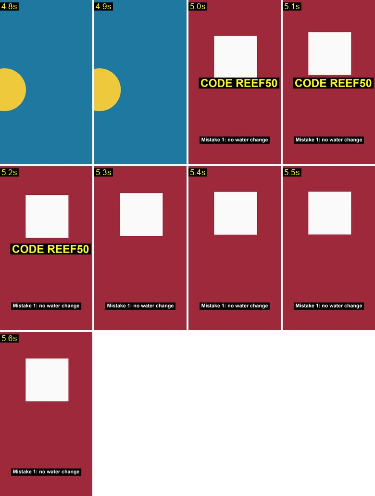

<div align="center">


# Instagram Scraper

**Give Claude eyes and ears on Instagram.**
A read-only [Claude Code](https://code.claude.com) plugin that fetches posts, reels, carousels, profiles and comments, and turns videos into something Claude can actually *watch and hear*, locally and at a fraction of the token cost.

[](https://github.com/doughrun/instagram-scraper/actions/workflows/ci.yml)
[](LICENSE)
[](https://code.claude.com/docs/en/plugins)
[](https://www.python.org)
[](#requirements)

[Install](#installation) · [What you can ask](#what-you-can-ask) · [How it works](#how-it-works) · [Commands](#command-reference) · [Privacy & safety](#privacy--safety) · [Troubleshooting](#troubleshooting) · [Contributing](CONTRIBUTING.md)

</div>

---

## Why

Ask Claude about an Instagram reel today and it hits a wall. Browser automation can see a page, but it
can't hear the audio or follow a video, and logged-out Instagram hides most of what matters.
**Instagram Scraper** closes that gap:

- **Every layer of a post:** caption, hashtags, mentions, tagged accounts, audio track, likes,
  comments *with replies*, location, paid-partnership flag, alt text, and the original photos and videos.
- **Video Claude can understand:** a local pipeline splits the video into scenes, reads every bit of
  on-screen text (OCR at 5 fps), transcribes the speech (Whisper), and packs it all into a short text
  **video map** plus a contact sheet. Claude reads that instead of thousands of frames.
- **Fully local processing:** OCR, transcription and frame analysis run on your machine. No
  third-party scraping APIs and no cloud transcription.
- **Automatic:** once installed, Claude uses it whenever a conversation involves Instagram. Paste
  a link and ask your question.

## What you can ask

```text
What is she saying in this reel? My Spanish isn't great. https://www.instagram.com/reel/…

Look at @some.creator. What do they post about, what performs best, and have they done paid partnerships?

Summarize the comments on this post. Are people actually happy with the product? https://www.instagram.com/p/…

Is the vacuum at around 0:12 in this video a real Dyson or a knockoff? https://www.instagram.com/reel/…

Write down the recipe from this cooking reel, including the quantities he says out loud.
```

Claude decides which steps it needs: fetch the post, read the video map, glance at a contact sheet,
zoom into one frame. You don't have to name the plugin or any command.

## How it works



1. **Fetching.** A hidden browser on your own logged-in profile opens the page like a normal visit, and
   the plugin reads the data Instagram sends to that page. It **never calls Instagram's private APIs
   directly**. That's both gentler on your account and more robust to endpoint changes.
2. **Video map, then zoom.** Instead of sending Claude every frame, the plugin makes everything
   that's cheap to detect into text:

   ```markdown
   # Video map — reel.mp4
   duration 15.0s · 1080x1920 · 10 segments · audio: yes · speech lang: en
   Contact sheets: sheet_01.jpg (~1036 tok)

   - #2  [00:00.4–00:03.0] · speech: "Here are three mistakes beginners make with reef tanks."
   - #6  [00:05.0–00:06.5] · text: "CODE REEF50" | "Mistake 1: no water change" · speech: "First, skipping water changes."
   - #10 [00:10.0–00:15.0] · text: "ACME" | "Follow for part 2" · speech: "Follow for part two."
   ```

   Claude reads the map, looks at one contact sheet, and zooms only where the question points.
   Above, a promo code that was on screen for **0.3 s** and a tiny corner logo were both caught by OCR
   without Claude viewing a single frame.

<table>
<tr>
<td width="40%"></td>
<td valign="top">

**Contact sheet**: one labeled tile per scene, about 1,000 tokens for the whole video.

**Range zoom**: every frame between two timestamps, when something happens fast:



**Crop zoom**: a full-resolution crop for fine detail, about 100 tokens:


</td>
</tr>
</table>

<sub>Demo images come from a synthetic test video generated for this repo.</sub>

### Token cost (30-second reel)

| Approach | Tokens Claude spends on images | Catches 0.3 s on-screen text? |
|---|---|---|
| Every frame at 10 fps | ~135,000 | yes |
| 40 evenly spaced key frames | ~18,000 | often misses it |
| **Video map + contact sheet (this plugin)** | **~1,000–2,500** | **yes, via OCR** |

Need more? Claude can zoom into any moment, or run `thorough` mode (every scene at full resolution),
which states its token cost and asks first.

## Requirements

| | |
|---|---|
| **Claude Code** | Recent version with plugin support |
| **[uv](https://docs.astral.sh/uv/)** | Runs the scripts and installs Python dependencies automatically, with no virtualenv to manage |
| **[ffmpeg](https://ffmpeg.org)** | Video decoding (`ffmpeg` and `ffprobe` on your `PATH`) |
| **Microsoft Edge or Google Chrome** | Used as the hidden browser. If neither is installed, Playwright's Chromium works too |
| **An Instagram account** | A **secondary account is strongly recommended** (see [Privacy & safety](#privacy--safety)) |
| **Optional: NVIDIA GPU** | Faster, more accurate transcription (opt-in, ~1 GB download) |

**Platform status:** Windows 11 is tested end to end. macOS is being tested now. Linux should work
but is untested; reports are welcome.

## Installation

### 1. Install the prerequisites

<details open>
<summary><b>Windows</b></summary>

```powershell
winget install --id=astral-sh.uv -e
winget install --id=Gyan.FFmpeg -e
```
</details>

<details>
<summary><b>macOS</b></summary>

```bash
brew install uv ffmpeg
```
</details>

<details>
<summary><b>Linux (Debian/Ubuntu)</b></summary>

```bash
curl -LsSf https://astral.sh/uv/install.sh | sh
sudo apt install ffmpeg
```
</details>

Open a new terminal afterwards so `uv` and `ffmpeg` are on your `PATH`.

### 2. Install the plugin in Claude Code

Inside Claude Code:

```text
/plugin marketplace add doughrun/instagram-scraper
/plugin install instagram-scraper@instagram-scraper
```

Then start a new Claude Code session so the skill loads.

### 3. First run: log in once

Ask Claude something like *"set up the Instagram scraper"*, or just paste an Instagram link. Claude will:

1. Check that `uv` and `ffmpeg` are available.
2. Ask whether you want the **GPU pack** (NVIDIA only) and whether it may add a **read permission**
   for the plugin's data folder, so it can view frames without a prompt for each image.
3. Open a **browser window once** so you can log in to Instagram normally (2FA and "is this you?"
   checks work, because it's a real browser). The window closes by itself when you're in.

From then on everything runs hidden. The session can last for months, until Instagram ends it.

> **Login window not working?** Run this yourself (the `!` prefix runs it in your Claude Code prompt)
> and paste your `sessionid` cookie when asked. The input is hidden and never passes through Claude:
> ```text
> ! uv run "<plugin-dir>/skills/instagram-scraper/scripts/ig.py" login --paste
> ```

### Updating & uninstalling

```text
/plugin marketplace update instagram-scraper
/plugin uninstall instagram-scraper@instagram-scraper
```

To remove your local data and login session, delete the data folder ([locations below](#where-your-data-lives)).

## Command reference

Claude runs these for you. They're documented here for transparency and power users.
Every command is `uv run <skill-dir>/scripts/ig.py <command>` and prints JSON.

| Command | Description |
|---|---|
| `post <url-or-shortcode>` | Full pipeline for one post, reel or carousel: data, comments and replies, media download, video map for every video. `--max-comments N` (200), `--no-comments`, `--no-transcribe`, `--no-video`, `--refresh` |
| `profile <user-or-url>` | Bio, stats, links, latest `--limit N` posts (12), plus a thumbnail contact sheet of the feed. `--deep` runs `post` on every post |
| `comments <url-or-shortcode>` | Compact, offline view of a fetched post's comments. `--limit`, `--sort likes\|time`, `--grep REGEX`, `--no-replies` |
| `zoom <video> --t T --region R` | Full-resolution crop at time T (`tl tr bl br top bottom left right center full`, or `--box x,y,w,h`) |
| `zoom <video> --start A --end B` | Contact sheet of every frame in a time range |
| `thorough <video> [--yes]` | Every scene at full resolution in quadrants. Estimates the token cost first |
| `video <file>` / `transcribe <file>` | The video pipeline for any local video file |
| `setup [--gpu] [--allow-read]` | Check prerequisites, log in if needed, optional extras |
| `login [--paste]` · `status` | Session management. `status` shows which account is in use |

**Exit codes:** `0` ok · `1` error · `2` bad input or not found · `3` not logged in or security check · `4` rate-limited.

### What a fetched post looks like

```text
<data>/cache/posts/<shortcode>/
├── post.json              # caption, hashtags, mentions, tags, audio, stats, comments + replies
├── media/01.mp4, 02.jpg   # original files, carousel order
└── analysis/01/
    ├── video_map.md       # the text map Claude reads first
    ├── sheet_01.jpg       # contact sheet(s)
    ├── transcript.txt     # timestamped speech
    └── scan/              # 10 fps frames (for range zooms)
```

## Privacy & safety

**Read this before you use it.**

- **Read-only.** The plugin never likes, comments, follows, posts or sends messages.
- **Your session stays on your machine.** The login lives only in a dedicated browser profile inside
  the plugin's data folder. Your password is never stored, and the plugin never touches your everyday
  browser.
- **Processing is local.** Downloads, OCR, transcription and frame analysis run on your computer.
  **Images Claude looks at are sent to Anthropic** as part of your conversation, like any image you
  share with Claude.
- **Use a secondary Instagram account.** Automated access is against Instagram's Terms of Use, and
  Instagram can restrict accounts it believes are automated. The plugin is designed to be gentle:
  normal page visits only, human-paced pauses, one browser at a time, no bulk mode, and it **stops
  immediately when Instagram signals rate limiting** rather than retrying. You are still responsible
  for how you use it.
- **Respect people.** Comments and posts belong to their authors. Don't use this to harass, track or
  profile private individuals, and follow the laws that apply to you (e.g. GDPR).

### Where your data lives

| OS | Data folder |
|---|---|
| Windows | `%LOCALAPPDATA%\instagram-scraper\` |
| macOS | `~/Library/Application Support/instagram-scraper/` |
| Linux | `~/.local/share/instagram-scraper/` |

Set `IG_SKILL_DATA_DIR` to use a different folder.

## Performance

Approximate times from test runs on Windows 11 (32-core CPU, RTX 3060 Ti):

| Task | Time |
|---|---|
| Profile (12 posts + thumbnail sheet) | ~15 s |
| Image post + 30 comments | ~25 s |
| 18 s reel + 60 comments, full video map | ~90 s |
| 43 s reel, video map only | ~80 s |

OCR dominates video time and runs on the CPU, so a video takes roughly **1–2× its length** to
analyze. Comments are read at a human pace, about 30 s per 200.

## Troubleshooting

| Symptom | Fix |
|---|---|
| `session_expired` | Your Instagram session ended. Ask Claude to log in again, or run `setup`. |
| `checkpoint` | Instagram wants a security check. Open Instagram in your browser or app, confirm it's you, then retry. |
| `rate_limited` | Instagram is throttling the account. **Stop and wait a few hours.** Don't retry in a loop. |
| `busy` | Another Instagram command is running. They run one at a time. |
| `no_browser` | Install Edge or Chrome, or run `uv run --with playwright playwright install chromium`. |
| `missing_prereqs` | Install `ffmpeg`/`uv` (see [Installation](#installation)) and open a new terminal. |
| A permission prompt for every frame | Run `setup --allow-read`, or allow reads of the [data folder](#where-your-data-lives) in Claude Code. |
| Transcription is slow | Run `gpu-setup` if you have an NVIDIA GPU. CPU transcription uses a smaller model. |

## FAQ

**Is this an official Instagram or Meta product?**
No. It isn't affiliated with, endorsed by, or sponsored by Meta or Instagram.

**Why not use the official Instagram API?**
The Graph API only covers business and creator accounts *you manage*. It can't read arbitrary public
posts, reel audio, or comment threads on other accounts.

**Why do view counts show as `null`?**
Instagram only shows view counts to the account owner.

**Why are there fewer replies than `reply_count`?**
Instagram counts replies it hides (deleted or restricted), so it can't return all of them.

**Does it work on private accounts?**
Only accounts your logged-in account can already see. Otherwise you get the profile header only.

**Can it download stories or highlights?**
Not yet. See the roadmap.

## Roadmap

- [ ] GPU-accelerated OCR (about 7× faster in early tests)
- [ ] macOS and Linux verification in CI with a recorded fixture
- [ ] Stories and highlights
- [ ] Optional MCP server exposing the same tools
- [ ] Hashtag and location pages

Ideas and votes welcome in [Discussions](https://github.com/doughrun/instagram-scraper/discussions) and [Issues](https://github.com/doughrun/instagram-scraper/issues).

## Contributing

Contributions are very welcome: bug reports, Instagram layout changes you've spotted, platform
testing, docs. Start with [CONTRIBUTING.md](CONTRIBUTING.md). Everyone taking part is expected to
follow the [Code of Conduct](CODE_OF_CONDUCT.md). Found a security issue? See [SECURITY.md](SECURITY.md).

## Acknowledgements

Built with [Playwright](https://playwright.dev), [faster-whisper](https://github.com/SYSTRAN/faster-whisper),
[RapidOCR](https://github.com/RapidAI/RapidOCR), [FFmpeg](https://ffmpeg.org), [Pillow](https://python-pillow.org),
and [uv](https://github.com/astral-sh/uv).

## License

[MIT](LICENSE) © 2026 doughrun

<sub>Instagram is a trademark of Meta Platforms, Inc. This project is independent and not affiliated
with Meta. Use it responsibly and in line with Instagram's Terms of Use and the laws that apply to you.</sub>
